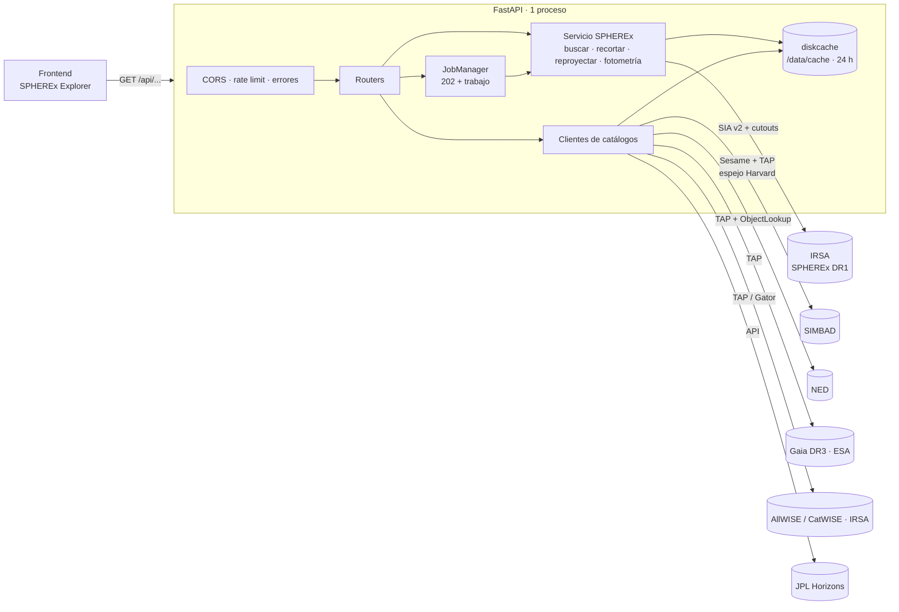
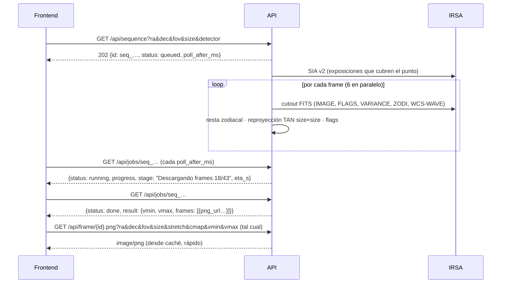

# SPHEREx Sky API — Backend (FastAPI + Docker)

Backend del **SPHEREx Explorer**: una herramienta web pública para ver cómo cambia el cielo en las
imágenes de la misión **SPHEREx** de la NASA (102 bandas infrarrojas, 0.75–5 µm, todo el cielo cada
6 meses). Funciona como un **comparador de parpadeo (blink)** sincronizado con un **espectrómetro**:

1. Recibe coordenadas (RA/Dec) o un nombre (`Barnard's star`, `WISE 0855`…) y un campo de visión (FOV).
2. Busca en IRSA todas las exposiciones de SPHEREx que cubren ese punto, las recorta, **las alinea píxel a
   píxel** (misma rejilla TAN, norte arriba, este a la izquierda) y las entrega como PNG listos para animar.
3. Permite **apilar** (más señal/ruido) o **restar épocas** (T2 − T1): las estrellas fijas se anulan y lo que se
   movió o cambió de brillo resalta en ámbar/cian.
4. Cruza la región con **SIMBAD, NED, Gaia DR3 y WISE** para marcar estrellas conocidas (con su movimiento
   propio propagado a la fecha de la imagen) y galaxias fijas. Lo que se mueve y no está en catálogos es un
   **candidato a descubrimiento**.
5. Mide el **espectro** de cualquier punto (fotometría de apertura en cada exposición → un punto por
   longitud de onda; ordenados por fecha sirven como **curva de luz**) con las **banderas de contaminación**.
6. **Predice** dónde estará un objeto en cada fecha con imágenes (movimiento propio + paralaje para
   estrellas/enanas marrones, efemérides de JPL Horizons para asteroides y cometas).

El Frontend solo habla con esta API; la API habla con IRSA (SPHEREx, WISE), CDS (SIMBAD), NED, ESA (Gaia) y JPL.

> 📘 **Documentación de la API** (APIs externas que usamos, qué devuelve cada endpoint y para qué sirve,
> ejemplos reales): [`docs/DOCUMENTACION_API.md`](docs/DOCUMENTACION_API.md)
> · **Swagger**: <http://localhost:8000/docs> · **OpenAPI**: [`docs/openapi.yaml`](docs/openapi.yaml)
> · **Probar todo**: `./scripts/probar_api.sh`
> · **Ejemplos reales de cada servicio** (qué devuelve y para qué sirve): [`docs/EJEMPLOS_REALES.md`](docs/EJEMPLOS_REALES.md)

---

## Índice

- [Arranque rápido (Docker)](#arranque-rápido-docker)
- [Modo mock (sin red)](#modo-mock-sin-red)
- [Arquitectura](#arquitectura)
- [Estructura del proyecto](#estructura-del-proyecto)
- [Endpoints](#endpoints)
- [Patrón 202 + trabajo (procesos lentos)](#patrón-202--trabajo-procesos-lentos)
- [Geometría de las imágenes](#geometría-de-las-imágenes)
- [Épocas, movimiento propio y paralaje](#épocas-movimiento-propio-y-paralaje)
- [Espectro y curva de luz](#espectro-y-curva-de-luz)
- [Banderas de contaminación (flags)](#banderas-de-contaminación-flags)
- [Errores, fuentes parciales, timeouts](#errores-fuentes-parciales-timeouts)
- [Caché](#caché)
- [Límite de peticiones](#límite-de-peticiones)
- [Configuración (variables de entorno)](#configuración-variables-de-entorno)
- [Nuevos data releases de SPHEREx](#nuevos-data-releases-de-spherex)
- [Objetivos de calibración del reto](#objetivos-de-calibración-del-reto)
- [Integración con el Frontend](#integración-con-el-frontend)
- [Tests](#tests)
- [Decisiones y supuestos](#decisiones-y-supuestos)
- [Despliegue](#despliegue)

---

## Arranque rápido (Docker)

Requisitos: Docker Desktop (o Docker Engine + Compose v2).

```bash
cd NasaSpace
docker compose up --build
```

- API: <http://localhost:8000>
- Documentación interactiva (Swagger): <http://localhost:8000/docs>
- OpenAPI JSON: <http://localhost:8000/openapi.json>

Prueba rápida:

```bash
curl "http://localhost:8000/api/status"
curl "http://localhost:8000/api/resolve?name=Barnard's%20star"
curl "http://localhost:8000/api/frames?ra=133.795129&dec=-7.245147&limit=5"
```

Comandos útiles:

```bash
docker compose up -d --build        # en segundo plano
docker compose logs -f api          # ver logs
docker compose down                 # parar (la caché se conserva en el volumen sky-cache)
docker compose down -v              # parar y BORRAR la caché
API_PORT=9000 docker compose up     # publicar en otro puerto
```

Para personalizar la configuración: `cp backend/.env.example backend/.env` y edita (ver
[Configuración](#configuración-variables-de-entorno)).

### Sin Docker (desarrollo)

```bash
cd backend
python3.12 -m venv .venv && source .venv/bin/activate
pip install -r requirements.txt
CACHE_DIR=./cache uvicorn app.main:app --reload --port 8000
```

---

## Modo mock (sin red)

Con `SPHEREX_MODE=mock` el backend genera **FITS sintéticos con la misma estructura que SPHEREx**
(extensiones IMAGE, FLAGS, VARIANCE, ZODI) en lugar de descargar de IRSA: cielo determinista con estrellas
fijas, una fuente con movimiento propio alto (tipo enana marrón, más brillante en el infrarrojo largo),
una estrella variable y rayos cósmicos marcados. Todo el pipeline (recorte → reproyección → PNG, apilado,
resta, fotometría) se ejecuta igual.

```bash
SPHEREX_MODE=mock docker compose up --build
```

Útil para que el Frontend desarrolle sin depender de IRSA, para demos sin internet y para los tests.
Los catálogos (SIMBAD, NED, Gaia, WISE) siguen siendo reales. `/api/status` indica `MODO MOCK` en
`data_release`.

---

## Arquitectura



Flujo de una secuencia (blink):



**Stack:** FastAPI · httpx (async) · astropy (FITS, WCS, tiempos, coordenadas) · reproject (alineado)
· numpy · matplotlib (solo mapas de color) · Pillow (PNG) · diskcache (caché en disco) · uvicorn.

---

## Estructura del proyecto

```
NasaSpace/
├── docker-compose.yml
├── README.md                      ← este documento
├── docs/
│   ├── DOCUMENTACION_API.md       ← APIs externas + referencia de cada endpoint
│   ├── openapi.json / openapi.yaml← especificación OpenAPI (Swagger) exportada
├── scripts/
│   └── probar_api.sh              ← prueba todos los endpoints con curl + jq
└── backend/
    ├── Dockerfile
    ├── requirements.txt
    ├── .env.example
    ├── app/
    │   ├── main.py                ← app FastAPI, CORS, middlewares, routers
    │   ├── config.py              ← variables de entorno y límites de validación
    │   ├── errors.py              ← forma única de error, 502/504 cuando fallan las fuentes
    │   ├── http.py                ← cliente HTTP: timeout 10 s + 1 reintento, TAP/VOTable, salud de fuentes
    │   ├── cache.py               ← diskcache, redondeo a 1″, singleflight (sin trabajo duplicado)
    │   ├── jobs.py                ← patrón 202 + trabajo (id determinista, cola, progreso, ETA)
    │   ├── ratelimit.py           ← token bucket por IP → 429 + Retry-After
    │   ├── astro.py               ← propagación pm + paralaje, WCS TAN de salida, proyección gnomónica
    │   ├── render.py              ← estiramientos, mapas de color, PNG, resta ámbar/cian, capa de flags
    │   ├── schemas.py             ← esquemas de respuesta y ejemplos para Swagger
    │   ├── utils.py
    │   ├── spherex/
    │   │   ├── __init__.py        ← servicio: buscar, registrar ids, recortes, reproyección, fotometría
    │   │   ├── base.py            ← FrameMeta, Cutout, lectura de FITS SPHEREx, bits de flags
    │   │   ├── irsa.py            ← proveedor real (SIA v2 + cutouts de IRSA)
    │   │   └── mock.py            ← proveedor sintético (SPHEREX_MODE=mock)
    │   ├── sources/
    │   │   ├── resolver.py        ← nombre → coordenadas (Sesame/SIMBAD → NED), alias del reto
    │   │   ├── catalogs.py        ← conos SIMBAD/NED, clasificación star/galaxy/other
    │   │   ├── overlay.py         ← Gaia DR3 y WISE
    │   │   └── horizons.py        ← efemérides de JPL Horizons
    │   ├── services/
    │   │   ├── imaging.py         ← secuencia y apilado/resta
    │   │   └── analysis.py        ← espectro y predicción
    │   └── routers/               ← un archivo por grupo de endpoints del contrato
    │       ├── catalogs.py  images.py  analysis.py  system.py  common.py
    └── tests/                     ← pytest (sin red: modo mock + catálogos simulados)
```

---

## Endpoints

Base: `http://localhost:8000`. Todos son `GET`. Listas en query: `?a=x&a=y` **o** `?a=x,y`.

| Endpoint | Tipo | Qué hace |
|---|---|---|
| `/api/resolve?name=&at=` | rápido | Nombre → coordenadas (SIMBAD, luego NED). Devuelve `current` propagada a `at`. |
| `/api/objects?ra&dec&radius&catalogs&types&limit` | rápido | Objetos SIMBAD/NED en un cono, ordenados por distancia. |
| `/api/frames?ra&dec&fov&detector&date_from&date_to&limit&offset` | rápido | Metadatos de las exposiciones (sin imágenes), ordenadas por fecha, con `total`. |
| `/api/coverage?ra&dec&detector` | rápido | Exposiciones por semana (histograma del selector de fechas). |
| `/api/sequence?ra&dec&fov&size&detector&date_from&date_to&stretch&cmap&scale&limit&offset` | **202** | Recorta, alinea y prepara los frames; devuelve `png_url` de cada uno. |
| `/api/frame/{id}.png?ra&dec&fov&size&stretch&cmap&vmin&vmax` | PNG | Render de un frame. Usar las `png_url` tal cual. |
| `/api/stack?ra&dec&fov&size&stretch&cmap&op&a&b` | **202** | `mean`/`median`/`sum` de `a`, o `diff` = media(a) − media(b). Máx. 100 ids por lista. |
| `/api/stack/{id}.png` | PNG | Imagen del apilado (`png_url` de `StackResult`). |
| `/api/spectrum?ra&dec&aperture&date_from&date_to` | **202** | Un punto por exposición: λ, flujo (µJy), error, fecha, detector, frame, flags. |
| `/api/predict?ra&dec&name&date_from&date_to` | **202** | Posición predicha del objeto en cada fecha con imágenes. |
| `/api/overlay?ra&dec&fov&catalog=gaia\|wise&at` | rápido | Fuentes Gaia/WISE en el campo, propagadas a `at`. |
| `/api/jobs/{id}` | rápido | Estado de un trabajo (`queued`/`running`/`done`/`failed`). |
| `/api/status` | rápido | Versión, data release y salud/latencia de cada fuente externa. |

**Extras** (no están en el contrato v0.3, no rompen nada):

- `/api/frame/{id}/flags.png?ra&dec&fov&size` — capa PNG transparente con los píxeles con banderas en ámbar,
  misma geometría que el frame (para el checkbox "Banderas de contaminación"). Cada frame de la secuencia trae
  su `flags_png_url`.
- Campos adicionales en respuestas: `band_exact`, `obs_id`, `vmin/vmax` por frame, `partial`/`warnings` en
  secuencia y apilado, `catalog_epoch` y `catalog_ra/dec` en overlay, `object_type` en resolve,
  `n_exposures` en espectro, `parallax_mas`/`catalog_position` en predict.
- `/healthz` (healthcheck de Docker) y `/` → redirige a `/docs`.

### Ejemplos

```bash
# Resolver con propagación a una fecha
curl "http://localhost:8000/api/resolve?name=Barnard's%20star&at=2026-06-01"
```

```json
{
  "query": "Barnard's star",
  "matched_name": "Barnard's star",
  "ra": 269.452076, "dec": 4.693364,
  "source": "simbad",
  "epoch": 2000.0,
  "pm": {"ra": -801.551, "dec": 10362.394},
  "parallax_mas": 546.9759,
  "current": {"ra": 269.44612, "dec": 4.76998, "epoch": 2026.415}
}
```

```bash
# Objetos en 2′ alrededor de WISE 0855 (solo estrellas)
curl "http://localhost:8000/api/objects?ra=133.795129&dec=-7.245147&radius=120&types=star"

# Frames del detector 6 (4.42–5.00 µm, donde brillan las enanas marrones frías)
curl "http://localhost:8000/api/frames?ra=133.795129&dec=-7.245147&detector=6"

# Secuencia → 202 con un Job; luego sondear /api/jobs/{id}
curl "http://localhost:8000/api/sequence?ra=133.795129&dec=-7.245147&fov=300&size=512&detector=6"
curl "http://localhost:8000/api/jobs/seq_1a2b3c4d5e6f"

# Resta entre épocas (ids sacados de /api/frames o de la secuencia)
curl "http://localhost:8000/api/stack?ra=133.795129&dec=-7.245147&op=diff&a=sx-d6-1763100000000&b=sx-d6-1747300000000"

# Espectro en una apertura de 6″
curl "http://localhost:8000/api/spectrum?ra=133.795129&dec=-7.245147&aperture=6"

# Overlay Gaia propagado a la fecha de la imagen
curl "http://localhost:8000/api/overlay?ra=269.446&dec=4.770&fov=300&catalog=gaia&at=2025-10-01"

# Dónde está Barnard en cada fecha con imágenes
curl "http://localhost:8000/api/predict?ra=269.446&dec=4.770&name=Barnard's%20star&date_from=2025-05-01&date_to=2026-11-01"
```

---

## Patrón 202 + trabajo (procesos lentos)

`/api/sequence`, `/api/stack`, `/api/spectrum` y `/api/predict` pueden tardar decenas de segundos.

1. El cliente llama al endpoint.
2. **Si el resultado está en caché → `200` con el resultado.**
3. Si no → **`202` con un `Job`**. El `id` es **determinista** (prefijo + hash de la consulta normalizada:
   `seq_`, `stk_`, `spc_`, `prd_`), así que la misma consulta devuelve siempre el mismo trabajo y no se
   duplica el cálculo aunque varios usuarios la pidan a la vez.
4. El cliente consulta `GET /api/jobs/{id}` cada `poll_after_ms` (800 ms en curso, 1500 ms en cola) hasta
   `status: done | failed`. Con `done`, el resultado viene en `result`; con `failed`, en `error`.

```json
{
  "id": "seq_8f3a12c0b1d2", "kind": "sequence", "status": "running",
  "progress": 0.42, "eta_s": 9, "stage": "Descargando frames 18/43",
  "queue_position": 0, "poll_after_ms": 800, "created_at": "2026-11-14T10:00:00Z",
  "result": null, "error": null
}
```

- Como mucho `MAX_CONCURRENT_JOBS` (2) corren a la vez; el resto espera con `queue_position` ≥ 1.
- `eta_s` se estima con el progreso (o con la duración media de trabajos anteriores si está en cola).
- Los trabajos viven en memoria `JOB_TTL_S` (1 h); el resultado queda en caché 24 h. Si el trabajo ya expiró
  de memoria pero el resultado sigue en caché, `/api/jobs/{id}` lo devuelve como `done`. Si no, `404`.
- Un trabajo `failed` se puede reintentar repitiendo la misma consulta pasados `FAILED_JOB_RETRY_S` (30 s).
- Si falla una parte de los frames, el trabajo termina igualmente con `partial: true` y `warnings`.

---

## Geometría de las imágenes

Todos los PNG (frames y apilados) salen **reproyectados**: proyección tangente (TAN), **norte arriba, este a la
izquierda**, centrados en el `ra/dec` pedido, cuadrados de `size × size` píxeles que cubren `fov` segundos de
arco por lado. Todos los frames de una secuencia quedan **alineados píxel a píxel** y el Frontend puede dibujar
cualquier coordenada encima:

```
escala = size / fov                                   (px por ″)
x = size/2 − (ra − ra0) · cos(dec0) · 3600 · escala   (desde el borde izquierdo)
y = size/2 − (dec − dec0) · 3600 · escala             (desde el borde superior)
```

Implementación (`astro.target_wcs` + `spherex._reproject`):

1. Se pide a IRSA un recorte del FITS original de ~1.45 × fov (margen para la rotación del detector).
   Del recorte se descarta la tabla `EPSF` (~3.8 MB) antes de cachearlo: 4 MB → ~160 KB por recorte.
2. Se resta la luz zodiacal (extensión `ZODI`) para que el fondo no "parpadee" entre épocas.
3. Se limpian los defectos de píxel individual (`CLEAN_BAD_PIXELS`): los píxeles con TRANSIENT (rayos
   cósmicos), OVERFLOW, SUR_ERROR, NONFUNC, MISSING_DATA, HOT, COLD u OUTLIER, y los NaN, se rellenan con la
   media de sus vecinos 3×3 válidos. Sin esto, la resta queda dominada por rayos cósmicos. La capa
   `flags_png_url` sigue mostrando dónde estaban.
4. Se reproyecta con `reproject_interp` (bilineal) a un WCS TAN con `CRPIX = size/2 + 0.5`,
   `CDELT = (−fov/size, +fov/size)/3600`. El píxel nativo de SPHEREx (≈ 6.2″) se remuestrea a `size`.
5. Fuera de la cobertura del detector el PNG es **transparente** (alfa 0).
6. El centro se redondea a 1″ (la clave de caché); el `center` de la respuesta es el usado de verdad.

Estiramientos: `linear`, `sqrt`, `log`, `asinh` (por defecto). Mapas: `gray`, `viridis`, `magma`, `inferno`.

**Escala de brillo** (`scale` en `/api/sequence`):
- `sequence` (por defecto): los mismos `vmin/vmax` (percentiles 0.5–99.5 de todos los frames) → los cambios
  de brillo son reales. Necesario para estrellas variables (RW Aur, R Dra).
- `frame`: cada frame con sus propios percentiles.

Las `png_url` ya incluyen toda la query (`ra, dec, fov, size, stretch, cmap, vmin, vmax`); **úsalas tal cual**.
Si cambias `stretch`/`cmap`/`vmin`/`vmax` en el Frontend, puedes reescribir esos parámetros: el recorte
reproyectado está en caché y el render es inmediato.

**Resta (`op=diff`)**: `media(a) − media(b)`, escala simétrica `±vmax` (percentil 99.5 de |diferencia|);
positivos en **ámbar** (`#FFB000`), negativos en **cian** (`#00E5FF`); `cmap` se ignora. Una estrella que se
movió aparece como pareja cian (posición antigua) + ámbar (posición nueva).

---

## Épocas, movimiento propio y paralaje

Los catálogos dan posiciones en su propia época: **SIMBAD J2000.0**, **Gaia DR3 2016.0**,
**AllWISE 2010.56** (CatWISE 2015.4). Para estrellas rápidas (Barnard ≈ 10.4″/año) esa posición ya no
coincide con las imágenes de SPHEREx (2025+).

- `/api/resolve` devuelve `ra/dec` de catálogo (época `epoch`) **y** `current`, la posición propagada a `at`
  (hoy por defecto). **El Frontend debe centrar la vista en `current`.**
- `/api/overlay` devuelve cada fuente ya propagada a `at` (la fecha del frame que se está mostrando), con su
  `pm`, y `epoch` = la época de esas posiciones.
- La propagación (`astro.propagate`) aplica **movimiento propio** (desplazamiento esférico exacto) **más
  paralaje anual** cuando hay paralaje (posición baricéntrica de la Tierra de astropy). Para Barnard el
  paralaje mueve la estrella ±0.55″, menos de un píxel, pero se incluye por exactitud.

`/api/predict`:
- Con `name` → SIMBAD (Sesame). Si tiene movimiento propio → `method: "proper_motion"`. Si no está en SIMBAD
  o no tiene pm → **JPL Horizons** (asteroides, cometas, planetas) → `method: "ephemeris"`, geocéntrico.
- Sin `name` → el objeto de SIMBAD con movimiento propio conocido más cercano al centro (radio 5′).
- Fechas: las de las exposiciones de SPHEREx en el rango (agrupadas al minuto, máx. 500); si no hay, semanales.
- `sigma_arcsec` crece con el tiempo: `√(σ_pos² + (σ_pm·Δt)²)`; con Horizons usa la incertidumbre 3σ del
  objeto / 3.

---

## Espectro y curva de luz

SPHEREx usa filtros lineales variables: **la longitud de onda depende de dónde cae la fuente en el detector**,
así que cada exposición aporta un punto distinto del espectro.

Para cada exposición que cubre el punto (`services/analysis.build_spectrum` + `spherex._aperture`):

1. Recorte pequeño del FITS (apertura + anillo de fondo).
2. λ exacta en el píxel del objetivo desde la extensión **`WCS-WAVE`** (WCS alternativo `W`, tabla `-TAB`).
   Si no se puede leer, se usa el centro de banda del SIA y el punto lleva `wavelength_exact: false`.
3. Fotometría de apertura circular de radio `aperture` (mínimo 0.75 px), fondo = mediana en un anillo
   (`r_in = max(2·ap, ap + 12.4″)`, ancho 18.6″) excluyendo píxeles con banderas.
4. Conversión: `Σ(I − fondo) [MJy/sr] × Ω_píxel [sr] × 10¹² = µJy`. Error desde la extensión `VARIANCE`
   más la incertidumbre del fondo.
5. Banderas de los píxeles dentro de la apertura.

Los puntos salen **ordenados por longitud de onda**; cada uno trae `date_obs`, así que **ordenados por fecha
son una curva de luz** (estrellas variables). Para objetos que se mueven, acota con `date_from/date_to`.
Máximo `MAX_SPECTRUM_FRAMES` (600) exposiciones por petición (se muestrean uniformemente si hay más).

El Frontend puede sombrear las bandas moleculares: H₂O ~1.4, 1.9, 2.7–3.0 µm · CH₄ ~1.65, 2.2, 3.3 µm ·
CO₂ ~4.27 µm · CO ~4.6–4.7 µm.

---

## Banderas de contaminación (flags)

Cada frame trae `flags`: las banderas activas **en el píxel del objetivo** (radio 1.5 px nativos). En el
espectro, las de la apertura. `FrameFlag` es un **enum abierto**.

El backend **lee la definición de bits de la cabecera de la extensión `FLAGS`** de cada FITS
(`MSKNnnnn = NOMBRE` del plano *n*, como en SPHEREx DR1), así que si SPHEREx añade o cambia banderas en un
release futuro, se recogen solas. La tabla de respaldo (`spherex/base.py → DEFAULT_FLAG_BITS`) coincide con la
cabecera real de DR1:

| Bit | SPHEREx DR1 | Significado | Se publica como |
|---|---|---|---|
| 0 | TRANSIENT | Transitorio detectado en la rampa (rayo cósmico) | `cosmic_ray` |
| 1 | OVERFLOW | Desbordamiento (saturación) | `saturation` |
| 2 | SUR_ERROR | Error en el procesado a bordo | `fit_error` |
| 6 | NONFUNC | Píxel inutilizable | `nonfunctional` |
| 7 | DICHROIC | Baja eficiencia por el dicroico | `dichroic` |
| 9 | MISSING_DATA | Datos perdidos a bordo | `missing_data` |
| 10 | HOT | Píxel caliente | `hot_pixel` |
| 11 | COLD | Señal anómalamente baja | `cold_pixel` |
| 14 | PHANMISS | Corrección de "phantom" no aplicada | `phantom_uncorrected` |
| 15 | NONLINEAR | No linealidad no corregible | `nonlinear` |
| 17 | PERSIST | Carga persistente | `persistence` |
| 19 | OUTLIER | Marcado por detección de outliers | `outlier` |
| 20 | CROSSTALK | Diafonía | `crosstalk` |
| 22 | GHOST | Fantasma de fuente brillante en la exposición | `ghost` |
| 23 | GHOST_FPA | Fantasma de fuente brillante en otro detector | `ghost_fpa` |
| 24 | GHOST_EXT | Fantasma de fuente brillante fuera del campo | `ghost_ext` |
| 25 | STREAK | Estela (satélite, etc.) | `streak` |
| 26 | BLOOM | Artefacto de "bloom" | `bloom` |
| 27 | SNOWBALL | Artefacto "snowball" | `snowball` |
| 28 | HALO | Halo transitorio | `halo` |
| 12, 21 | FULLSAMPLE, SOURCE | Informativas (no indican contaminación) | (no se publican) |

Para cambiar los nombres publicados: `FLAG_ALIASES` en `spherex/base.py`.

Además, `flags_png_url` da una capa con **todos** los píxeles con banderas del recorte.

En `/api/frames` (rápido, sin descargar imágenes) `flags` está vacío y `band_um` es el centro de la banda
del detector (`band_exact: false`) **hasta que ese frame se procesa** en una secuencia; después se rellenan
con los valores medidos.

---

## Errores, fuentes parciales, timeouts

Todos los errores tienen la misma forma:

```json
{"error": {"code": "bad_request", "message": "radius supera el máximo (600)"}}
```

| HTTP | `code` | Cuándo |
|---|---|---|
| 400 | `bad_request` | Falta un parámetro, fuera de rango (`ra ∉ [0,360)`, `dec ∉ [−90,90]`, `radius > 600`, `fov ∉ [10, 3600]`, `size ∉ [64, 1024]`, > 100 ids…), enum inválido, `date_from > date_to`, `diff` sin `b`. |
| 404 | `not_found` | Nombre no encontrado en SIMBAD ni NED, frame desconocido, trabajo o apilado expirado, ruta inexistente. |
| 429 | `rate_limited` | Demasiadas peticiones desde la IP (cabecera `Retry-After`). |
| 502 | `upstream_error` | Fallaron **todas** las fuentes pedidas. |
| 504 | `upstream_timeout` | Se agotó el tiempo en **todas** las fuentes pedidas. |
| 500 | `internal_error` | Error inesperado (se registra en logs). |

- **Timeout por fuente externa: 10 s, con 1 reintento** (5xx, 429, timeouts y errores de red; los 4xx no se
  reintentan). Las descargas de FITS usan `DOWNLOAD_TIMEOUT_S` (60 s) y la búsqueda SIA
  `SPHEREX_SEARCH_TIMEOUT_S` (20 s) porque IRSA puede ser más lento; ambos configurables (pon 10 si quieres
  el contrato estricto).
- **Si falla solo una de las fuentes pedidas → 200 con `partial: true`** y el motivo en `warnings`
  (p. ej. `/api/objects` con SIMBAD bien y NED caído).
- En los trabajos, el error va dentro del Job: `status: failed`, `error: {code, message}`.

---

## Caché

- **Clave = (consulta, fuente)**, coordenadas **redondeadas a 1″**, **vigencia 24 h** (`CACHE_TTL_S`).
- En disco (`diskcache`, LRU, límite `CACHE_SIZE_LIMIT_GB` = 5 GB) en el volumen Docker `sky-cache`:
  sobrevive a reinicios.
- Qué se cachea: búsquedas SIA, recortes FITS crudos, recortes reproyectados (float32), resultados de trabajos,
  imágenes de apilados, resoluciones de nombres, conos de SIMBAD/NED, Gaia/WISE (sin propagar; la propagación
  a `at` se hace en cada petición).
- El registro de ids de frame (`id → URL del FITS`) dura 30 días; si un id no está, se vuelve a buscar en el
  `ra/dec` de la petición, así las `png_url` siguen funcionando aunque la caché se haya limpiado.
- **Índice local de huellas**: cada exposición encontrada se guarda (30 días) con su huella en el cielo
  (`s_region`). Si la búsqueda de IRSA cae (502), la API calcula qué exposiciones conocidas cubren el punto
  pedido y responde `200` con `partial: true` y un aviso, en lugar de fallar. Solo da 502 si no conoce
  ninguna exposición de esa zona. (Los recortes FITS usan otro servicio de IRSA que suele seguir funcionando.)
- *Singleflight*: si dos peticiones necesitan el mismo recorte a la vez, se descarga una sola vez.
- Las respuestas con campo `cache` dicen `hit` o `miss`. Los PNG llevan `Cache-Control: public, max-age=86400`.

---

## Límite de peticiones

Token bucket por IP: `RATE_LIMIT_PER_MIN` (120/min) con ráfaga `RATE_LIMIT_BURST` (40). Excedido → `429` +
`Retry-After`. **No cuentan** `/api/jobs/*` (polling), los PNG (`/api/frame/*`, `/api/stack/*.png`) ni
`/api/status`. Detrás de un proxy, pon `TRUST_PROXY=true` para usar `X-Forwarded-For`.
`RATE_LIMIT_PER_MIN=0` lo desactiva.

---

## Configuración (variables de entorno)

Ver `backend/.env.example`. Las más importantes:

| Variable | Por defecto | Descripción |
|---|---|---|
| `SPHEREX_MODE` | `irsa` | `irsa` (datos reales) o `mock` (sintéticos, sin red). |
| `SPHEREX_COLLECTION` | `spherex_dr1` | Colección(es) SIA v2 de IRSA (separadas por coma). |
| `DATA_RELEASE` | `SPHEREx DR1 (IRSA…)` | Texto que devuelve `/api/status`. |
| `ZODI_SUBTRACT` | `true` | Restar la extensión ZODI antes de mostrar/medir. |
| `CLEAN_BAD_PIXELS` | `true` | Rellenar rayos cósmicos, píxeles calientes/fríos, NaN… con sus vecinos. |
| `EXTERNAL_TIMEOUT_S` / `EXTERNAL_RETRIES` | `10` / `1` | Tiempo máximo y reintentos por fuente. |
| `SPHEREX_SEARCH_TIMEOUT_S` | `20` | Timeout de la búsqueda SIA. |
| `SPHEREX_SEARCH_RETRIES` | `2` | Reintentos de la búsqueda SIA, con espera creciente (0.4 s, 0.8 s). |
| `DOWNLOAD_TIMEOUT_S` | `60` | Timeout de descarga de recortes FITS. |
| `DOWNLOAD_CONCURRENCY` | `6` | Descargas simultáneas a IRSA. |
| `MAX_CONCURRENT_JOBS` | `2` | Trabajos lentos simultáneos (el resto en cola). |
| `MAX_SPECTRUM_FRAMES` | `600` | Máximo de exposiciones por espectro. |
| `WISE_CATALOG` | `allwise` | `allwise` o `catwise` (CatWISE2020, mejor pm para enanas marrones). |
| `CACHE_DIR` / `CACHE_TTL_S` / `CACHE_SIZE_LIMIT_GB` | `/data/cache` / `86400` / `5` | Caché. |
| `JOB_TTL_S` | `3600` | Cuánto vive un trabajo terminado en memoria. |
| `RATE_LIMIT_PER_MIN` / `RATE_LIMIT_BURST` | `120` / `40` | Límite por IP. |
| `TRUST_PROXY` | `false` | Usar `X-Forwarded-For` para la IP. |
| `SIMBAD_TAP_MIRROR` | espejo de Harvard | El reintento de SIMBAD va contra el espejo. |
| `IRSA_GATOR_URL` | Gator de IRSA | Respaldo de WISE si el TAP de IRSA falla. |
| URLs (`IRSA_SIA_URL`, `SIMBAD_TAP_URL`, `NED_TAP_URL`, `GAIA_TAP_URL`, `HORIZONS_URL`…) | servicios oficiales | Por si hay que usar un espejo. |

---

## Nuevos data releases de SPHEREx

El reto pide que sea fácil actualizar con los nuevos datos. No hay nada que reprocesar ni base de datos que
cargar: el backend consulta IRSA en vivo y cachea 24 h.

1. Datos nuevos dentro de la misma colección → aparecen solos en ≤ 24 h (o `docker compose down -v` para
   vaciar la caché y verlos al instante).
2. Nueva colección: cambia `SPHEREX_COLLECTION` (admite varias separadas por coma, p. ej.
   `spherex_dr1,spherex_dr2`) y `DATA_RELEASE`, y reinicia. **Esto ya pasó durante el desarrollo**: la
   colección inicial `spherex_qr` (Quick Release) quedó vacía y los datos están ahora en `spherex_dr1`; el
   cambio fue una sola variable. Para ver qué colecciones existen:
   `https://irsa.ipac.caltech.edu/SIA?POS=CIRCLE+133.795+-7.245+0.0003&FACILITY=SPHEREx` → columna
   `obs_collection`. La versión de colección forma parte de
   la clave de caché, así que no se mezclan resultados viejos.
3. Si cambian los bits de calidad, se leen de la cabecera `FLAGS` automáticamente.

---

## Objetivos de calibración del reto

| Objetivo | Nombre para `/api/resolve` | Interés |
|---|---|---|
| Barnard's Star | `Barnard's star` | pm ≈ 10.4″/año → se ve moverse entre épocas (≈ 5″ en 6 meses, casi 1 píxel). |
| Epsilon Indi B | `epsilon indi b` (alias → `eps Ind B`) | Par de enanas marrones, pm ≈ 4.7″/año. |
| WISE 0855 | `WISE 0855` (alias → `WISE J085510.83-071442.5`) | Enana marrón más fría conocida, pm ≈ 8″/año. RA 08h55m10.831s, Dec −7°14′42.53″ = **133.795129, −7.245147**. Casi invisible en el azul, brillante en el detector 6. |
| RW Aurigae | `RW Aur` | Estrella variable: usar `scale=sequence` y el espectro/curva de luz. |
| R Draconis | `R Dra` | Variable Mira (período ~245 días): cambia mucho de brillo entre épocas. |

Los alias cortos están en `sources/resolver.py → ALIASES`.

Receta para ver moverse a WISE 0855:

```
/api/resolve?name=WISE 0855                         → current.ra/dec
/api/sequence?ra=…&dec=…&fov=300&detector=6         → blink
/api/stack?op=diff&a=<frame más nuevo>&b=<frame más viejo>  → pareja cian/ámbar
/api/overlay?catalog=gaia&at=<fecha del frame>      → la mayoría de puntos coinciden con Gaia; WISE 0855 no está en Gaia
/api/spectrum?ra=…&dec=…&aperture=6                 → espectro rojo con absorción de CH4/H2O
```

---

## Integración con el Frontend

Polling del patrón 202 (TypeScript):

```ts
const API = "http://localhost:8000";

export async function runJob<T>(path: string, onProgress?: (job: any) => void): Promise<T> {
  let res = await fetch(API + path);
  if (res.status === 200) return res.json();               // en caché
  if (res.status !== 202) throw (await res.json()).error;  // {code, message}
  let job = await res.json();
  while (job.status === "queued" || job.status === "running") {
    onProgress?.(job);                                     // progress, eta_s, stage, queue_position
    await new Promise(r => setTimeout(r, job.poll_after_ms));
    job = await (await fetch(`${API}/api/jobs/${job.id}`)).json();
  }
  if (job.status === "failed") throw job.error;
  return job.result as T;
}

// Uso
const seq = await runJob<any>(`/api/sequence?ra=${ra}&dec=${dec}&fov=300&detector=6`, j => setProgress(j));
const urls = seq.frames.map((f: any) => API + f.png_url);  // usar tal cual
```

Dibujar una fuente (de `/api/overlay` o `/api/objects`) sobre el PNG mostrado a `W` píxeles en pantalla:

```ts
const k = W / seq.size_px;
const escala = seq.size_px / seq.fov_arcsec;
const x = (seq.size_px / 2 - (src.ra - seq.center.ra) * Math.cos(seq.center.dec * Math.PI / 180) * 3600 * escala) * k;
const y = (seq.size_px / 2 - (src.dec - seq.center.dec) * 3600 * escala) * k;
```

URL compartible: el Frontend puede leer `?ra=…&dec=…&fov=…` y llamar a la API con esos valores; como las
consultas son deterministas, quien abra el enlace obtiene el mismo trabajo/caché.

---

## Tests

**Script de pruebas contra la API en marcha** (servicios reales, 32 comprobaciones, guarda los PNG en
`./salida_pruebas/`):

```bash
./scripts/probar_api.sh            # todo
./scripts/probar_api.sh --rapido   # sin procesos lentos
```

**Tests unitarios** — se ejecutan **sin red** (modo mock + catálogos simulados con monkeypatch):

```bash
docker compose run --rm api pytest -q
```

Cubren: forma de los errores y mensajes de validación, 404 de rutas y trabajos, CORS, la fórmula de geometría
del contrato contra el WCS real, propagación del movimiento propio de Barnard, `resolve` con `current`,
`objects` parcial (200 + `partial`) y total (504), frames/coverage, el flujo completo
secuencia → PNG → caché 200 → resta → PNG, y el espectro.

---

## Decisiones y supuestos

- **Fuentes de SPHEREx**: búsqueda por **SIA v2 de IRSA** (`COLLECTION=spherex_dr1`, punto de 1″ → frames que
  contienen el centro; solo `dataproduct_type=image`, se excluyen los cubos) y recortes con el **servicio de cutouts de IRSA** (`?center=ra,dec&size=grados` sobre la
  `access_url`), que devuelve el FITS multi-extensión recortado. Si IRSA cambia el nombre de la colección, basta
  con la variable de entorno.
- **Ids de frame**: `sx-d{detector}-{t_min en ms Unix}`, como en el ejemplo del contrato. Único por exposición y
  detector.
- **Detector** a partir del rango de longitudes de onda (`em_min/em_max`) del SIA (respaldo: `D1…D6` en
  nombres). `band_um` en `/api/frames` es aproximado hasta procesar el frame.
- **`center`/`fov_arcsec` de cada `Frame`** = centro de apuntado y tamaño (~3.5°) de la exposición completa.
  La región del PNG es la del nivel superior de la respuesta.
- **Nombres**: SIMBAD se consulta a través de **Sesame** (CDS) porque tolera variantes de escritura
  (`Barnard's star`, `barnard star`…); NED vía su ObjectLookup.
- **Conos**: SIMBAD TAP (`basic`, con reintento contra el espejo de Harvard), NED TAP (`NEDTAP.objdir`,
  tipo en `prefphytype`), Gaia ESA TAP (`gaiadr3.gaia_source`), IRSA TAP (`allwise_p3as_psd` /
  `catwise_2020`) con Gator como respaldo.
- **`/api/objects` no propaga**: devuelve posiciones de catálogo (el contrato no tiene `at` aquí). Para un objeto
  rápido como WISE 0855 la posición J2000 de SIMBAD está a ~3.5′ de la actual; usa `/api/resolve` (`current`)
  y `/api/overlay` (propagado) para dibujar sobre las imágenes.
- **Overlay**: se consulta el círculo que circunscribe el cuadro y se filtra al cuadrado exacto (proyección
  gnomónica) tras propagar. Máximo 5000 fuentes, las más brillantes.
- **Clasificación** star/galaxy/other a partir de `otype` (SIMBAD) y `pretype` (NED); el valor original va en
  `type_raw`.
- **Un solo proceso uvicorn**: los trabajos viven en memoria. Para escalar horizontalmente habría que mover la
  cola a Redis (p. ej. RQ/Celery) — la interfaz de `jobs.py` está aislada para eso.
- **Título** de la API: se mantiene `SpaceX Sky API` tal como viene en el contrato.

---

## Verificación con datos reales

Probado de punta a punta contra los servicios reales (noviembre 2026, SPHEREx DR1):

| Prueba | Resultado |
|---|---|
| `resolve` Barnard's star | SIMBAD, pm (−801.6, +10362.4) mas/año, `current` propagada con pm + paralaje |
| `resolve` WISE 0855 | `WISEA J085510.74-071442.5` (BD*), pm −8.1″/año en RA |
| `resolve` nombre inexistente | 404 `not_found` con el mensaje del contrato |
| `overlay` Gaia en Barnard | 559 fuentes; Barnard propagada coincide con `resolve.current` al 0.001″ |
| `overlay` WISE en WISE 0855 | 101 fuentes (vía Gator con el TAP de IRSA caído) |
| `frames` / `coverage` WISE 0855 | 258 exposiciones (45 en el detector 6), 2025‑05‑05 → 2026‑05‑14 |
| `sequence` 6 frames D6 | ~10 s; λ exacta por frame desde `WCS-WAVE` (4.41–5.00 µm) |
| `stack diff` Barnard (D2, 2025‑08 vs 2026‑03) | dipolo ámbar al norte / cian al sur = movimiento hacia el norte ✔ |
| `spectrum` Barnard (12″) | 232 puntos 0.74–4.96 µm en 213 s; `partial: true` por 503 puntuales de IRSA; flags de saturación ✔ |
| `predict` Barnard / Ceres | `proper_motion` en 121 fechas reales / `ephemeris` vía JPL Horizons |
| 45 peticiones seguidas | 429 + `Retry-After` a partir de la 43 |

Durante las pruebas IRSA devolvió 502/503 intermitentes y SIMBAD (CDS) estuvo en mantenimiento: por eso existen
los reintentos, el espejo de SIMBAD, el respaldo Gator y las respuestas parciales.

---

## Despliegue

La imagen es autocontenida (`python:3.12-slim`, usuario no root, healthcheck en `/healthz`):

```bash
docker build -t spherex-sky-api ./backend
docker run -d -p 8000:8000 -v sky-cache:/data/cache -e SPHEREX_MODE=irsa spherex-sky-api
```

Sirve en cualquier plataforma de contenedores (Render, Railway, Fly.io, Cloud Run, una VM). Recomendaciones:
un volumen persistente para `/data/cache`, 1–2 GB de RAM, y `TRUST_PROXY=true` si va detrás de un balanceador.
# NasaSpace
