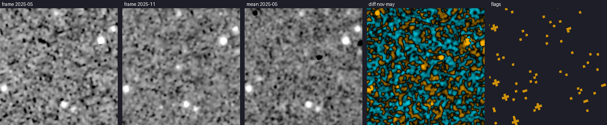
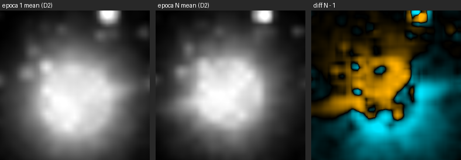

# Ejemplos reales de cada servicio

Todos los endpoints ejecutados contra la API con **datos reales de SPHEREx DR1** (noviembre 2026).
Para cada uno: **comando**, **qué devuelve**, **qué datos son** y **para qué sirve** en el Frontend.

> Referencia completa de parámetros y campos: [`DOCUMENTACION_API.md`](DOCUMENTACION_API.md) ·
> Swagger: <http://localhost:8000/docs> · Probar todo de una vez: `./scripts/probar_api.sh`

**Coordenadas usadas en los ejemplos**

| Objetivo | RA | Dec | Por qué |
|---|---|---|---|
| WISE 0855 (posición actual) | `133.757901` | `-7.242058` | Enana marrón más fría conocida, se mueve 8″/año |
| Barnard's Star (posición actual) | `269.446227` | `4.769463` | Estrella que más rápido se mueve en el cielo (10.4″/año) |
| M31 (Andrómeda) | `10.6847` | `41.2690` | Para ver galaxias de NED |

```bash
B=http://localhost:8000/api
W="ra=133.757901&dec=-7.242058"      # WISE 0855
BA="ra=269.446227&dec=4.769463"      # Barnard
```

---

## Índice

1. [`/api/status`](#1-apistatus--estado-del-sistema)
2. [`/api/resolve`](#2-apiresolve--nombre--coordenadas)
3. [`/api/objects`](#3-apiobjects--objetos-conocidos-alrededor)
4. [`/api/frames`](#4-apiframes--qué-imágenes-hay)
5. [`/api/coverage`](#5-apicoverage--imágenes-por-semana)
6. [`/api/overlay`](#6-apioverlay--gaia-o-wise-sobre-la-imagen)
7. [`/api/sequence`](#7-apisequence--la-secuencia-blink)
8. [`/api/frame/{id}.png`](#8-apiframeidpng--imagen-de-un-frame)
9. [`/api/stack` (mean / diff)](#9-apistack--sumar-o-restar-épocas)
10. [`/api/stack/{id}.png`](#10-apistackidpng--imagen-del-apilado)
11. [`/api/spectrum`](#11-apispectrum--espectro-y-curva-de-luz)
12. [`/api/predict`](#12-apipredict--dónde-estará-el-objeto)
13. [`/api/jobs/{id}`](#13-apijobsid--progreso-de-los-procesos-lentos)
14. [Cómo se encadenan en la app](#14-cómo-se-encadenan-en-la-app)
15. [⚠️ Error típico: espectro de un objeto que se mueve](#15-️-error-típico-espectro-de-un-objeto-que-se-mueve)
16. [Asteroides — modelo ML (`POST /api/asteroids/*`)](#16-asteroides--modelo-ml-post-apiasteroids)

---

## Vista general de las imágenes



*Zona de WISE 0855, detector 6 (4.4–5.0 µm), 300″ de lado, 256 px. De izquierda a derecha:
frame de mayo 2025 · frame de noviembre 2025 · suma (mean) de mayo · resta noviembre − mayo · capa de flags.*

---

## 1. `/api/status` — estado del sistema

```bash
curl "$B/status"
```

```json
{
  "status": "degraded",
  "version": "0.3.0",
  "data_release": "SPHEREx DR1 (IRSA, colección spherex_dr1)",
  "spherex_mode": "irsa",
  "sources": {
    "spherex":  {"ok": false, "latency_ms": null, "last_error": "HTTP 502"},
    "simbad":   {"ok": true,  "latency_ms": 749,  "last_error": null},
    "ned":      {"ok": true,  "latency_ms": 298,  "last_error": null},
    "gaia":     {"ok": true,  "latency_ms": 979,  "last_error": null},
    "wise":     {"ok": false, "latency_ms": null, "last_error": "HTTP 502"},
    "horizons": {"ok": true,  "latency_ms": 566,  "last_error": null}
  }
}
```

| Dato | Qué es |
|---|---|
| `status` | `ok` si todas las fuentes responden, `degraded` si alguna falla |
| `data_release` | Versión de los datos de SPHEREx que se están usando |
| `sources.*.ok` | Si cada API externa responde |
| `sources.*.latency_ms` | Cuánto tarda en responder |
| `sources.*.last_error` | Último error de esa fuente |

**Para qué sirve:** indicador verde/rojo en la barra superior del Frontend y saber qué data release se muestra.
En el ejemplo, IRSA (spherex y wise) estaba caído; la API siguió funcionando con la caché y el índice local.

---

## 2. `/api/resolve` — nombre → coordenadas

**API externa:** SIMBAD (vía Sesame) → si no lo encuentra, NED.

```bash
curl "$B/resolve?name=WISE%200855"
```

```json
{
  "query": "WISE 0855",
  "matched_name": "WISEA J085510.74-071442.5",
  "ra": 133.81890825,
  "dec": -7.247048,
  "source": "simbad",
  "epoch": 2000.0,
  "pm": {"ra": -8123.7, "dec": 673.2},
  "parallax_mas": 439.0,
  "current": {"ra": 133.75790055, "dec": -7.24205796, "epoch": 2026.87},
  "object_type": "BD*"
}
```

| Dato | Qué es | En el ejemplo |
|---|---|---|
| `matched_name` | Nombre oficial en el catálogo | `WISEA J085510.74-071442.5` |
| `ra`, `dec` | Posición del catálogo en su época | Año 2000 |
| `source` | De dónde salió | SIMBAD |
| `pm` | Movimiento propio (milisegundos de arco por año) | 8.1″/año hacia el oeste |
| `parallax_mas` | Paralaje → distancia = 1000 / paralaje | 439 mas → **2.3 pársecs** (7.4 años luz) |
| `current` | **Posición propagada a hoy** (o a `at`) | 2026.87 |
| `object_type` | Tipo de objeto | `BD*` = enana marrón |

**Para qué sirve:** el buscador de la barra superior. **El Frontend debe centrar la vista en `current`**:
WISE 0855 se movió **3.6′** desde la posición del año 2000; si se centra en `ra/dec`, no aparece.

### Con fecha (`at`)

```bash
curl "$B/resolve?name=Barnard%27s%20star&at=2025-08-15"
```

```json
{
  "matched_name": "Barnard's star",
  "ra": 269.4520769586187, "dec": 4.69336496657667, "epoch": 2000.0,
  "pm": {"ra": -801.551, "dec": 10362.394},
  "parallax_mas": 546.9759,
  "current": {"ra": 269.44623088, "dec": 4.76715389, "epoch": 2025.619}
}
```

**Para qué sirve:** saber dónde estaba el objeto **en la fecha de una imagen concreta**.

### Nombre que no existe

```bash
curl "$B/resolve?name=Estrella%20Falsa"
```

```json
{"error": {"code": "not_found", "message": "No encontramos \"Estrella Falsa\" en SIMBAD ni en NED."}}
```

**Para qué sirve:** mostrar el mensaje tal cual al usuario (HTTP 404).

---

## 3. `/api/objects` — objetos conocidos alrededor

**APIs externas:** SIMBAD TAP + NED TAP.

```bash
curl "$B/objects?$W&radius=120&limit=3"
```

```json
{
  "center": {"ra": 133.757778, "dec": -7.241944},
  "radius_arcsec": 120.0,
  "counts": {"simbad": 1, "ned": 55},
  "objects": [
    {"name": "WISEA J085501.95-071428.1", "source": "ned", "type": "other", "type_raw": "", "distance_arcsec": 3.177},
    {"name": "WISEA J085500.29-071420.2", "source": "ned", "type": "other", "type_raw": "", "distance_arcsec": 25.806},
    {"name": "WISEA J085459.79-071430.6", "source": "ned", "type": "other", "type_raw": "", "distance_arcsec": 30.864}
  ],
  "partial": false,
  "warnings": [],
  "cache": "hit"
}
```

Galaxias en Andrómeda:

```bash
curl "$B/objects?ra=10.6847&dec=41.2690&radius=60&types=galaxy&limit=3"
```

```json
{
  "counts": {"simbad": 3, "ned": 7},
  "objects": [
    {"name": "M  31",       "source": "simbad", "type": "galaxy", "type_raw": "AGN", "z": -0.0010, "distance_arcsec": 0.501},
    {"name": "Messier 031", "source": "ned",    "type": "galaxy", "type_raw": "G",   "z": -0.00099, "distance_arcsec": 0.662},
    {"name": "[CHM2007] LDC 31 J004244.33+4116074", "source": "simbad", "type": "galaxy", "type_raw": "GiG", "z": -0.00099, "distance_arcsec": 1.068}
  ]
}
```

| Dato | Qué es |
|---|---|
| `counts` | Cuántos objetos encontró cada catálogo |
| `name`, `source` | Nombre y catálogo de origen |
| `type` | `star`, `galaxy` u `other` |
| `type_raw` | Tipo original (`AGN`, `G` = galaxia, `BD*` = enana marrón…) |
| `z` | Corrimiento al rojo (en galaxias) |
| `distance_arcsec` | Distancia al centro (la lista viene ordenada por esto) |
| `partial` / `warnings` | Si uno de los dos catálogos falló |

**Para qué sirve:** las capas de catálogo del visor:
- `star` → anillo cian ("ya conocida").
- `galaxy` → marcador tenue ("galaxia de fondo, ignorar").
- **Lo que se mueve y no está en esta lista es candidato a descubrimiento.**

> Las posiciones son las del catálogo, sin propagar. Para dibujar sobre una imagen de una fecha concreta usar
> `/api/overlay`.

---

## 4. `/api/frames` — qué imágenes hay

**API externa:** IRSA (buscador SIA de SPHEREx). Rápido, no descarga imágenes.

```bash
curl "$B/frames?$W&detector=6&limit=2"
```

```json
{
  "total": 45,
  "partial": false,
  "frames": [
    {"id": "sx-d6-1746463682419", "date_obs": "2025-05-05T16:48:02.419Z", "detector": 6,
     "band_um": 4.9674, "band_exact": true, "exposure_s": 113.5826, "flags": []},
    {"id": "sx-d6-1746463811414", "date_obs": "2025-05-05T16:50:11.414Z", "detector": 6,
     "band_um": 5.0034, "band_exact": true, "exposure_s": 113.5826, "flags": []}
  ]
}
```

| Dato | Qué es |
|---|---|
| `total` | Cuántas exposiciones hay en total (45 del detector 6) |
| `id` | Identificador del frame (`sx-d<detector>-<milisegundos>`) |
| `date_obs` | Fecha y hora de la foto (UTC) |
| `detector` | 1 a 6 (cada uno cubre un rango de infrarrojo) |
| `band_um` | Longitud de onda en ese punto, en micras |
| `band_exact` | `true` si se midió en el FITS; `false` si es aproximada (aún no procesado) |
| `exposure_s` | Tiempo de exposición (≈ 114 s) |
| `flags` | Problemas de calidad en ese punto |

**Para qué sirve:** la barra de tiempo del reproductor y elegir los `id` para `/api/stack`.

---

## 5. `/api/coverage` — imágenes por semana

**API externa:** IRSA.

```bash
curl "$B/coverage?$W"
```

```json
{
  "first_date": "2025-05-05",
  "last_date": "2026-05-14",
  "total": 258,
  "weeks": [
    {"week_start": "2025-05-05", "count": 30},
    {"week_start": "2025-10-27", "count": 24},
    {"week_start": "2025-11-03", "count": 48},
    {"week_start": "2025-11-10", "count": 38},
    {"week_start": "2025-12-08", "count": 18},
    {"week_start": "2026-04-20", "count": 30},
    {"week_start": "2026-04-27", "count": 38},
    {"week_start": "2026-05-04", "count": 20},
    {"week_start": "2026-05-11", "count": 12}
  ]
}
```

| Dato | Qué es |
|---|---|
| `first_date`, `last_date` | Primera y última imagen |
| `total` | Total de exposiciones (todos los detectores) |
| `weeks` | Cuántas imágenes hay cada semana (`week_start` = lunes) |

**Para qué sirve:** el histograma del selector de fechas. Se ven las **3 pasadas de SPHEREx** sobre este punto:
**mayo 2025 · noviembre 2025 · abril–mayo 2026** (una cada ~6 meses) → las marcas 2025‑S1, 2025‑S2, 2026‑S1 de la
línea de tiempo.

---

## 6. `/api/overlay` — Gaia o WISE sobre la imagen

**APIs externas:** Gaia DR3 (ESA) o AllWISE (IRSA).

```bash
curl "$B/overlay?$BA&fov=300&catalog=gaia&at=2025-08-15"
```

```json
{
  "catalog": "gaia",
  "epoch": 2025.619,
  "catalog_epoch": 2016.0,
  "sources": [
    {"id": "Gaia DR3 4472832130942575872",
     "ra": 269.44623125, "dec": 4.76715398,
     "mag": 8.19,
     "pm": {"ra": -801.55, "dec": 10362.39},
     "catalog_ra": 269.4485, "catalog_dec": 4.7394},
    "… 559 fuentes en total"
  ]
}
```

```bash
curl "$B/overlay?$W&fov=300&catalog=wise"
```

```json
{"catalog": "wise", "epoch": 2026.87, "catalog_epoch": 2010.5589, "mag_band": "W1",
 "sources": ["… 100 fuentes"]}
```

| Dato | Qué es |
|---|---|
| `epoch` | Fecha a la que se trasladaron las posiciones (= `at`) |
| `catalog_epoch` | Fecha original del catálogo (Gaia 2016, WISE 2010.56) |
| `sources[].ra/dec` | Posición **en la fecha del frame** → dibujar aquí |
| `sources[].mag` | Brillo (menor número = más brillante) → tamaño del marcador |
| `sources[].pm` | Vector de movimiento → flecha |
| `catalog_ra/dec` | Posición original sin trasladar |

**Para qué sirve:** la capa "Estrellas y movimiento propio" (anillos cian con flechas). Ejemplo: Barnard estaba
**100″ más al sur** en el catálogo de Gaia (2016); trasladada a la fecha del frame cae justo encima de la
estrella en la imagen (coincide con `/api/resolve` al 0.001″).

---

## 7. `/api/sequence` — la secuencia (blink)

**API externa:** IRSA (descarga los recortes FITS). **Proceso lento → 202 + trabajo.**

```bash
curl "$B/sequence?$W&fov=300&size=256&detector=6&limit=6"
```

La primera vez responde **202** con un trabajo:

```json
{"id": "seq_b88275e26582", "kind": "sequence", "status": "queued", "progress": 0.0,
 "eta_s": 45, "stage": "En cola", "queue_position": 1, "poll_after_ms": 1500}
```

Al terminar (o directamente con **200** si ya estaba en caché):

```json
{
  "size_px": 256,
  "fov_arcsec": 300,
  "scale": "sequence",
  "vmin": -0.080,
  "vmax": 0.448,
  "unit": "MJy/sr",
  "total": 45,
  "frames": [
    {"id": "sx-d6-1746463682419", "date_obs": "2025-05-05T16:48:02.419Z", "band_um": 4.9674,
     "png_url": "/api/frame/sx-d6-1746463682419.png?ra=133.757778&dec=-7.241944&fov=300&size=256&stretch=asinh&cmap=gray&vmin=-0.0804725&vmax=0.447733",
     "flags_png_url": "/api/frame/sx-d6-1746463682419/flags.png?ra=133.757778&dec=-7.241944&fov=300&size=256"},
    "… 6 frames"
  ]
}
```

| Dato | Qué es |
|---|---|
| `size_px`, `fov_arcsec` | Tamaño del PNG y de la zona del cielo (igual para todos los frames) |
| `scale`, `vmin`, `vmax` | Escala de brillo **compartida** → los cambios de brillo entre frames son reales |
| `total` | Cuántos frames hay (paginar con `offset`) |
| `frames[].png_url` | URL de la imagen, **lista para usar** |
| `frames[].flags_png_url` | Capa con los píxeles defectuosos |

**Para qué sirve:** el reproductor (Play / Pause / < > / velocidad). Todas las imágenes están **alineadas píxel a
píxel**, norte arriba, este a la izquierda: al reproducirlas, lo que se mueve "salta".

---

## 8. `/api/frame/{id}.png` — imagen de un frame

**API externa:** IRSA (solo si el recorte no está en caché).

```bash
curl -o frame.png "http://localhost:8000/api/frame/sx-d6-1746463682419.png?ra=133.757778&dec=-7.241944&fov=300&size=256&stretch=asinh&cmap=gray&vmin=-0.0804725&vmax=0.447733"
# → 200 image/png, 256×256, 61 KB
```

**Qué devuelve:** la imagen PNG (paneles 1 y 2 de la vista general). Transparente donde el detector no cubre.

**Para qué sirve:** pintarla en el visor central. Cambiando `stretch` (`linear`, `sqrt`, `log`, `asinh`) o `cmap`
(`gray`, `viridis`, `magma`, `inferno`) en la URL se vuelve a pintar al instante.

**Capa de flags** (último panel de la vista general):

```bash
curl -o flags.png "http://localhost:8000/api/frame/sx-d6-1746463682419/flags.png?ra=133.757778&dec=-7.241944&fov=300&size=256"
```

Píxeles con rayos cósmicos, saturación, píxeles calientes… en ámbar. **Para qué sirve:** el checkbox
"Banderas de contaminación".

---

## 9. `/api/stack` — sumar o restar épocas

**API externa:** IRSA. **Proceso lento → 202 + trabajo.**

### Suma (`mean`)

```bash
curl "$B/stack?$W&fov=300&size=256&op=mean&a=sx-d6-1746463682419,sx-d6-1746463811414,sx-d6-1746475295443"
```

```json
{"op": "mean", "n_frames": 3, "vmin": -0.046, "vmax": 0.416, "unit": "MJy/sr",
 "png_url": "/api/stack/stk_28b400449497.png", "partial": false, "warnings": []}
```

**Para qué sirve:** modo **Suma (Coadd)**. Al promediar varias fotos baja el ruido y aparecen fuentes débiles
(panel 3 de la vista general).

### Resta (`diff`)

```bash
curl "$B/stack?$W&fov=300&size=256&op=diff&a=<ids de noviembre>&b=<ids de mayo>"
```

```json
{"op": "diff", "n_frames": 6, "vmin": -0.194, "vmax": 0.194, "unit": "MJy/sr",
 "png_url": "/api/stack/stk_d547dd51cbdb.png", "partial": false, "warnings": []}
```

| Dato | Qué es |
|---|---|
| `op` | Operación hecha |
| `n_frames` | Frames usados de verdad |
| `vmin`, `vmax` | Escala; en `diff` es simétrica (±) |
| `png_url` | Imagen resultado |

**Para qué sirve:** modo **Diferencia (T2 − T1)**. Las estrellas fijas desaparecen. Lo que **se movió** sale como
una pareja **cian (dónde estaba) + ámbar (dónde está)**; lo que **cambió de brillo**, de un solo color.

Ejemplo real con **Barnard's Star** (detector 2, agosto 2025 vs marzo 2026):



Ámbar arriba (norte), cian abajo (sur): **la estrella se movió hacia el norte**, como predice su movimiento propio.

> ⚠️ En un campo débil como el de WISE 0855 (panel 4 de la vista general) la escala de la resta la marca el
> ruido y se ve "granulado". Para buscar movimiento conviene restar **sumas de varios frames por época** y
> usar un `fov` pequeño.

---

## 10. `/api/stack/{id}.png` — imagen del apilado

```bash
curl -o diff.png "http://localhost:8000/api/stack/stk_d547dd51cbdb.png"
# → 200 image/png
```

**Para qué sirve:** pintar el resultado de la suma o de la resta. No consulta APIs externas (sale de la caché).

---

## 11. `/api/spectrum` — espectro y curva de luz

**API externa:** IRSA (un recorte pequeño por exposición). **Proceso lento → 202 + trabajo.**

```bash
curl "$B/spectrum?$W&aperture=6&date_from=2025-11-01&date_to=2025-11-30"
```

```json
{
  "aperture_arcsec": 6,
  "wavelength_unit": "um",
  "flux_unit": "uJy",
  "n_exposures": 86,
  "points": [
    {"wavelength": 0.7451, "flux": 755.6, "error": 43.8,  "detector": 1, "date_obs": "2025-11-03", "flags": []},
    {"wavelength": 1.5121, "flux": 946.6, "error": 44.9,  "detector": 2, "date_obs": "2025-11-07", "flags": []},
    {"wavelength": 2.3807, "flux": 406.1, "error": 30.1,  "detector": 3, "date_obs": "2025-11-14", "flags": []},
    {"wavelength": 4.2190, "flux": 155.2, "error": 56.8,  "detector": 5, "date_obs": "2025-11-07", "flags": []},
    {"wavelength": 4.9791, "flux": 12.4,  "error": 135.4, "detector": 6, "date_obs": "2025-11-14", "flags": []},
    "… 84 puntos"
  ],
  "partial": true,
  "cache": "hit"
}
```

| Dato | Qué es |
|---|---|
| `points[].wavelength` | Longitud de onda en micras (exacta) → eje X |
| `points[].flux` | Brillo en microjanskys → eje Y |
| `points[].error` | Incertidumbre del brillo → barras de error |
| `points[].date_obs` | Fecha de la foto → ordenando por fecha = **curva de luz** |
| `points[].detector`, `frame_id` | De qué detector y foto sale el punto |
| `points[].flags` | Si trae `saturation`, `cosmic_ray`… **desconfiar del punto** |
| `n_exposures` | Exposiciones intentadas |
| `partial` | Alguna exposición no se pudo descargar |

**Para qué sirve:**
- El **gráfico espectral** del panel derecho (0.75 a 5 µm) con las franjas de H₂O, CH₄, CO y CO₂.
- Ordenando por `date_obs`: la **curva de luz** de estrellas variables (RW Aurigae, R Draconis).
- Si este punto se marca como fuente anómala, su espectro dice qué tipo de objeto es.

> ⚠️ **Este ejemplo NO es el espectro de WISE 0855**: ver la [sección 15](#15-️-error-típico-espectro-de-un-objeto-que-se-mueve).

---

## 12. `/api/predict` — dónde estará el objeto

**APIs externas:** SIMBAD (movimiento propio) o JPL Horizons (asteroides) + IRSA (fechas). **Lento → 202.**

### Estrella (movimiento propio)

```bash
curl "$B/predict?$BA&name=Barnard%27s%20star&date_from=2025-08-01&date_to=2026-04-01"
```

```json
{
  "target": "Barnard's star",
  "method": "proper_motion",
  "pm_mas_yr": {"ra": -801.6, "dec": 10362.4},
  "parallax_mas": 546.98,
  "positions": [
    {"date": "2025-08-15T20:45:11Z", "ra": 269.446229,  "dec": 4.7671599, "sigma_arcsec": 0.001},
    "… 116 posiciones (una por fecha con imágenes)",
    {"date": "2026-03-25T21:27:44Z", "ra": 269.4463683, "dec": 4.7688722, "sigma_arcsec": 0.001}
  ],
  "warnings": []
}
```

### Asteroide (efemérides de la NASA)

```bash
curl "$B/predict?ra=0&dec=0&name=Ceres&date_from=2025-06-01&date_to=2025-07-01"
```

```json
{"target": "Ceres", "method": "ephemeris",
 "positions": [{"date": "2025-06-16T09:04:16Z", "ra": 11.883, "dec": -6.166, "sigma_arcsec": null}, "… 28"]}
```

| Dato | Qué es |
|---|---|
| `method` | `proper_motion` (estrellas, SIMBAD) · `ephemeris` (asteroides/cometas, JPL) · `static` |
| `pm_mas_yr` | Movimiento propio usado |
| `positions[]` | Posición del objeto en **cada fecha con imágenes** |
| `positions[].sigma_arcsec` | Incertidumbre → radio del círculo |

**Para qué sirve:**
- Dibujar en cada frame el **círculo donde debe aparecer** el objeto (Barnard avanza 6.2″ al norte entre agosto
  y marzo).
- Calcular la "velocidad angular entre épocas" de la ficha de la fuente.
- Medir correctamente el espectro de objetos que se mueven (sección 15).

---

## 13. `/api/jobs/{id}` — progreso de los procesos lentos

```bash
curl "$B/jobs/seq_b88275e26582"
```

Mientras corre:

```json
{"id": "seq_b88275e26582", "kind": "sequence", "status": "running", "progress": 0.485,
 "eta_s": 9, "stage": "Descargando frames 3/6", "queue_position": 0, "poll_after_ms": 800,
 "result": null, "error": null}
```

Al terminar: `"status": "done"` y el resultado completo en `result`. Si falla: `"status": "failed"` y `error`.

Trabajo que no existe o expiró:

```json
{"error": {"code": "not_found", "message": "El trabajo seq_ffffffffffff no existe o expiró."}}
```

| Dato | Qué es |
|---|---|
| `status` | `queued` → `running` → `done` / `failed` |
| `progress` | 0 a 1 → barra de progreso |
| `eta_s` | Segundos restantes estimados |
| `stage` | Texto para mostrar ("Descargando frames 3/6", "Fotometría 120/239"…) |
| `queue_position` | 0 = trabajando; 1, 2… = en cola |
| `poll_after_ms` | Cuánto esperar antes de volver a preguntar |

**Para qué sirve:** la tarjeta de progreso y los *skeletons* mientras se calculan `sequence`, `stack`,
`spectrum` o `predict`.

---

## 14. Cómo se encadenan en la app

```
 Buscar          resolve ──────────────► current (centrar la vista)
                    │
 Línea de tiempo coverage + frames ─────► épocas e ids
                    │
 Reproductor     sequence ──────────────► png_url de cada frame (blink)
                    │
 Capas           overlay (Gaia/WISE) + objects (SIMBAD/NED) ─► marcadores sobre la imagen
                    │
 Modo resta      stack op=diff ─────────► qué cambió (cian / ámbar)
                    │
 Clic en fuente  predict ───────────────► dónde estaba en cada fecha
                    │
 Panel derecho   spectrum ──────────────► espectro 0.75–5 µm + curva de luz + flags
```

Los pasos lentos (`sequence`, `stack`, `spectrum`, `predict`) devuelven 202 la primera vez → sondear
`/api/jobs/{id}` → la siguiente vez la misma consulta devuelve 200 desde la caché.

---

## 15. ⚠️ Error típico: espectro de un objeto que se mueve

El espectro de la sección 11 se midió en la posición **actual** de WISE 0855 (2026.87), pero las imágenes son de
**noviembre 2025**. En ese año la enana marrón se movió **~8″**, así que la apertura de 6″ **no la contiene**: midió
otra fuente que está a 3″ (`WISEA J085501.95-071428.1`, la primera de `/api/objects`). Por eso el espectro sale
"azul" (más brillante a 0.75 µm), cuando una enana marrón fría casi no emite ahí y brilla a 4.5 µm.

**Flujo correcto para objetos que se mueven:**

```bash
# 1. ¿Dónde estaba en las fechas de las imágenes?
curl "$B/predict?$W&name=WISE%200855&date_from=2025-11-01&date_to=2025-11-30"
#    → positions[].ra/dec (p. ej. el de la mitad del rango)

# 2. Espectro en ESA posición y SOLO con las imágenes de esas fechas
curl "$B/spectrum?ra=<ra predicho>&dec=<dec predicho>&aperture=6&date_from=2025-11-01&date_to=2025-11-30"
```

Regla: **posición y fechas siempre juntas.** Cuanto más rápido se mueve el objeto, más corto el rango de fechas
(en una semana WISE 0855 se mueve ~0.15″, despreciable frente al píxel de 6.2″).

Para objetos fijos (galaxias, estrellas lentas, variables como RW Aur o R Dra) no hace falta: se puede usar
todo el rango de fechas, y ordenar los puntos por `date_obs` da la curva de luz.

---

## 16. Asteroides — `POST /api/asteroids/predict-from-current` (JPL Horizons)

El usuario marca el asteroide en el frame que está viendo y da su número MPC. El backend comprueba con JPL Horizons
(observador = SPHEREx) que el clic sea ese asteroide y devuelve dónde estará, la trayectoria y los píxeles para
dibujarla. Sin modelo de IA. **200 directo** (0.5 s la primera vez, 0.015 s con caché).

```bash
curl -s -X POST "$B/asteroids/predict-from-current" -H 'Content-Type: application/json' -d '{
  "asteroid_id": 3000,
  "current_observation": {"mjd_utc": 61280.27835825572, "ra": 60.39039387599737, "dec": 20.06447024678794},
  "horizon_days": 0.5,
  "image_id": "sx-d6-1787899193362",
  "view": {"ra": 60.3904, "dec": 20.0645, "fov": 1200, "size": 512}
}'
```

Respuesta real (resumida):

```json
{"target": "3000 Leonardo (1981 EG19)", "method": "horizons", "observer": "500@-163182",
 "current_observation": {"time": "2026-08-28T06:40:50.153Z", "offset_arcsec": 0.35,
                         "pixel": {"x": 256.009, "y_top": 256.046, "inside_image": true}},
 "predicted_ra_deg": 60.5815245, "predicted_dec_deg": 20.0863899, "forecast_time": "2026-08-28T18:40:50.153Z",
 "motion": {"arcsec_per_hour": 54.282, "position_angle_deg": 83.03},
 "pixel": {"x": null, "y_top": null, "inside_image": false, "image_id": "sx-d6-1787899193362",
           "image_date_obs": "2026-08-28T06:39:53.361Z", "in_frame_footprint": true},
 "track": [{"time": "2026-08-28T06:40:50.153Z", "pixel": {"x": 256.136, "y_top": 256.124, "inside_image": true}},
           {"time": "2026-08-28T08:10:50.153Z", "pixel": {"x": 221.776, "y_top": 250.494, "inside_image": true}},
           {"time": "2026-08-28T09:40:50.153Z", "pixel": {"x": 187.414, "y_top": 245.045, "inside_image": true}}, "…"],
 "warnings": [], "status": "ephemeris"}
```

- Leonardo se mueve 54″/h hacia el este (ángulo 83°): en 12 h recorre ~650″ y sale del campo de 1200″
  (`pixel.inside_image: false`). La trayectoria (`track`) sí trae los puntos que caen dentro: dibujar la línea con
  los que tienen `inside_image: true`.
- Este a la IZQUIERDA en la imagen (norte arriba): por eso `x` disminuye.
- Clic en otro sitio (61.0, 20.06) → `422 identity_mismatch`: "La posición marcada está a 2062″ de donde JPL
  Horizons pone a 3000 Leonardo…".
